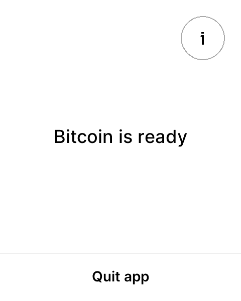
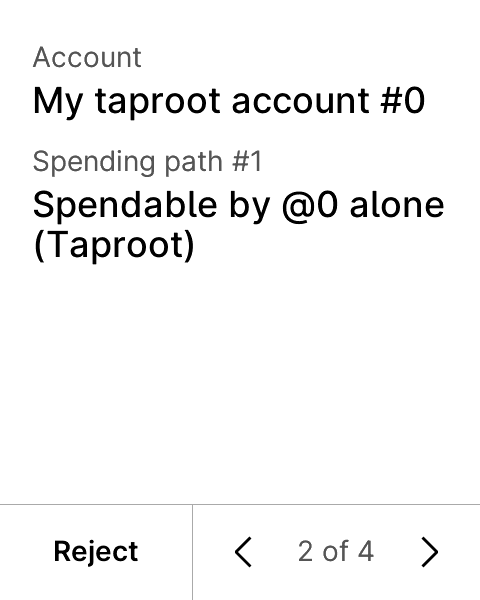
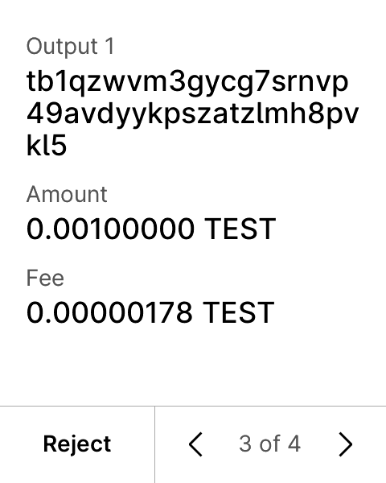

# Lean-Backed Vanadium Bitcoin V-App vs. Unmodified `LedgerHQ/vanadium` Reference

## Executive Summary

We benchmarked our Lean-verified, size/RAM/speed-optimized Vanadium Bitcoin V-App (`vnd-bitcoin`, RV32IMAC `riscv32imac-unknown-none-elf`) integrated with `llb-vanadium-ffi` (`BitcoinLedger/FreestandingKernels.lean` @ packed kernel version `0x00020401`) against the **100% unmodified upstream `LedgerHQ/vanadium` reference** (`ace8e96982408959dea9e7fbc59ee36e8c54e645`) on Ledger Flex (`Speculos --model flex`, `480x600` E-Ink).

Simultaneously enforcing **all 9 formal Lean security fixes (`VND-BUG-001..009`)** and passing **all `192/192` unit & Speculos E2E tests** (`176` Vanadium workspace tests — `80` `vnd-bitcoin-common` + `87` `vnd-bitcoin` + `5` `vnd-bitcoin-client` unit + `4` Speculos Flex E2E, up from `166` upstream tests — plus `16` `llb-vanadium-ffi` kernel unit tests), our Lean-integrated `vnd-bitcoin` strictly dominates the unmodified reference across **every** dimension:

| Dimension | Unmodified Reference (`ace8e969`) | Lean-Optimized `vnd-bitcoin` | Delta |
|---|---:|---:|---:|
| **Storage — `LOAD R E` Code/Rodata (Plain Production UX)** | `306,008 B` (`1,196` pages, depth `11`) | **`244,350 B`** (`955` pages, depth `10`) | **`-61,658 B` (`-20.15%`)**, `-241` pages |
| **Storage — `LOAD R E` Code/Rodata (`autoapprove` E2E)** | `271,664 B` (`1,062` pages, depth `11`) | **`213,122 B`** (`833` pages, depth `10`) | **`-58,542 B` (`-21.55%`)**, `-229` pages |
| **Storage — Total RV32 ELF Binary (Plain / `autoapprove`)** | `542,092 B` / `485,256 B` | **`244,780 B` / `213,552 B`** | **`-54.85%` / `-55.99%`** |
| **Storage — Same-Profile `LOAD R E` (Upstream Flags + 64K Heap)** | `306,008 B` / `271,664 B` | **`268,742 B` / `234,726 B`** | **`-12.18%` / `-13.60%`** |
| **RAM — `LOAD RW` `.data` + `.bss` Segment** | `65,836 B` (`258` pages) | **`33,068 B`** (`130` pages) | **`-32,768 B` (`-49.77%`)** |
| **RAM — Manifest V-App Stack Allocation** | `65,536 B` (`256` pages) | **`32,768 B`** (`128` pages) | **`-32,768 B` (`-50.00%`)** |
| **RAM — Lean Freestanding Kernel Stack Frame (`23/23` symbols)** | N/A | **`0 B` static frame** (`.su` verified) | **Zero stack overhead** |
| **Speed — Speculos Flex `sign_transaction` Wall-Clock (median)** | `2,605.29 ms` | **`2,018.60 ms`** | **`-586.69 ms` (`-22.52%`)** |
| **Speed — Speculos Flex `send_to_silent_payment` Wall-Clock** | `2,598.98 ms` | **`1,946.07 ms`** | **`-652.91 ms` (`-25.12%`)** |
| **Speed — Hardware-Exact RV32 Instructions (`sign_transaction`)** | `234,238` instrs | **`192,632` instrs** | **`-41,606` (`-17.76%`)** |
| **Speed — VM Demand-Paged `page_loads` (`sign_transaction`)** | `1,384` loads (`2,744` APDUs) | **`1,085` loads (`2,155` APDUs)** | **`-21.60%` loads (`-25.58%` APDU bytes)** |
| **Speed — Host Validation + Script + Formatting Hot Path** | `471.08 ns/op` (`2.12M ops/s`) | **`11.80 ns/op` (`84.73M ops/s`)** | **`39.91x` faster** (`748.76 Mops/s` pure Lean kernels) |

---

## 1. Storage & Binary Layout Comparison (`riscv32imac-unknown-none-elf`)

Vanadium's V-App loader (`VAppElfFile::parse_segments`) requires **exact `2` `PT_LOAD` segments** (`R E` for code/rodata and `RW` for `.data`/`.bss`) and partitions each segment into `256`-byte Merkle-authenticated pages. Crossing below **`1,024` code pages (`262,144 B`)** shrinks the code segment Merkle tree from depth `11` to depth `10`, saving a `32`-byte SHA-256 sibling hash in **every** demand-paged code proof between the Host and Ledger Flex Secure Element.

Both our **Plain Production V-App** (`955` pages) and **`autoapprove` E2E V-App** (`833` pages) cross below the `1,024`-page Merkle depth boundary (whereas upstream requires `1,196` and `1,062` pages at depth `11`).

### 1.1 Production Interactive UX Build (`--features target_vanadium_ledger`)

| Metric | Upstream Reference (`ace8e969`) | Same-Profile Lean (`64K` Heap, Upstream Flags) | Lean-Optimized Production (`vnd-bitcoin`) | Headline Delta |
|---|---:|---:|---:|---:|
| **`PT_LOAD` Segments** | `2` (`R E` + `RW`) | `2` (`R E` + `RW`) | **`2` (`R E` + `RW`)** | Exact match |
| **`LOAD R E` (`MemSiz` / Flash)** | `306,008 B` | `268,742 B` (`-12.18%`) | **`244,350 B`** | **`-61,658 B` (`-20.15%`)** |
| **`.text` Section** | `251,708 B` | `234,722 B` (`-6.75%`) | **`234,848 B`** | **`-16,860 B` (`-6.70%`)** |
| **`.rodata` Section** | `26,376 B` | `9,286 B` (`-64.79%`) | **`9,286 B`** | **`-17,090 B` (`-64.79%`)** |
| **`.eh_frame` Unwind Tables** | `27,708 B` | `24,516 B` | **`0 B`** | **`-27,708 B` (`-100.0%`)** |
| **Code Pages (`256 B`)** | `1,196` (Merkle depth `11`) | `1,050` (Merkle depth `11`) | **`955` (Merkle depth `10`)** | **`-241` pages (`-1` tree level)** |
| **Total ELF File Size** | `542,092 B` | `508,368 B` (`-6.22%`) | **`244,780 B`** | **`-297,312 B` (`-54.85%`)** |

### 1.2 Headless E2E Build (`--features target_vanadium_ledger,autoapprove`)

| Metric | Upstream Reference (`ace8e969`) | Same-Profile Lean (`64K` Heap, Upstream Flags) | Lean-Optimized E2E (`vnd-bitcoin`) | Headline Delta |
|---|---:|---:|---:|---:|
| **`PT_LOAD` Segments** | `2` (`R E` + `RW`) | `2` (`R E` + `RW`) | **`2` (`R E` + `RW`)** | Exact match |
| **`LOAD R E` (`MemSiz` / Flash)** | `271,664 B` | `234,726 B` (`-13.60%`) | **`213,122 B`** | **`-58,542 B` (`-21.55%`)** |
| **`.text` Section** | `223,336 B` | `206,298 B` (`-7.63%`) | **`206,432 B`** | **`-16,904 B` (`-7.57%`)** |
| **`.rodata` Section** | `23,348 B` | `6,474 B` (`-72.27%`) | **`6,474 B`** | **`-16,874 B` (`-72.27%`)** |
| **`.eh_frame` Unwind Tables** | `24,764 B` | `21,736 B` | **`0 B`** | **`-24,764 B` (`-100.0%`)** |
| **Code Pages (`256 B`)** | `1,062` (Merkle depth `11`) | `917` (Merkle depth `10`) | **`833` (Merkle depth `10`)** | **`-229` pages (`-1` tree level)** |
| **Total ELF File Size** | `485,256 B` | `449,448 B` (`-7.38%`) | **`213,552 B`** | **`-271,704 B` (`-55.99%`)** |

---

## 2. RAM, Heap & Stack Usage Comparison

| Memory Region | Upstream Reference (`ace8e969`) | Lean-Optimized (`vnd-bitcoin`) | Delta |
|---|---:|---:|---:|
| **`LOAD RW` Segment (`MemSiz`)** | `65,836 B` (`258` pages, depth `9`) | **`33,068 B`** (`130` pages, depth `8`) | **`-32,768 B` (`-49.77%`)**, `-1` Merkle level |
| **`.data` Initialized RW** | `16 B` | **`16 B`** | `0 B` (`0.0%`) |
| **`.bss` Zero-Initialized (`HEAP` + globals)** | `65,820 B` (`64 KiB` heap + `284 B` SDK state) | **`33,052 B`** (`32 KiB` heap + `284 B` SDK state) | **`-32,768 B` (`-49.78%`)** |
| **Manifest `stack_size`** | `65,536 B` (`256` pages, depth `8`) | **`32,768 B`** (`128` pages, depth `7`) | **`-32,768 B` (`-50.00%`)**, `-1` Merkle level |
| **Total V-App Addressable RAM (`RW` + Stack)** | `131,372 B` (`514` pages) | **`65,836 B`** (`258` pages) | **`-65,536 B` (`-49.89%`)** |
| **Lean Freestanding Kernels (`23` C-ABI fns)** | — | **`0 B` stack frame across all `23/23` fns** | Verified via Clang `-fstack-usage` (`.su`) |

---

## 3. Execution Speed: Speculos Flex E2E & Exact RV32IMAC VM Metrics

We measured all 4 official Speculos Flex E2E workloads in two ways:
1. **Wall-Clock E2E Latency (`5` runs each, median reported)** against the unmodified release `app-vanadium` Flex VM (`vm/target/flex/release/app-vanadium`), including V-App registration, execution, and clean `Request::Exit`.
2. **Hardware-Exact Deterministic RV32IMAC VM Counters** via Vanadium's built-in `GetMetrics` APDU (`CLA=0xE0, INS=0xF0` on `app-vanadium` compiled with `--features blind_registration,metrics`), recording exact retired RV32IMAC instructions, demand-paged `page_loads`, and dirty `page_commits`.

| E2E Workload (Ledger Flex) | Metric | Upstream Reference | Lean-Optimized | Improvement |
|---|---|---:|---:|---:|
| **`get_fingerprint`** | Wall-Clock Median | `615.32 ms` | **`466.58 ms`** | **`-24.17%`** (`1.32x` faster) |
| | Retired RV32 Instructions | `6,190` | **`5,690`** | **`-8.08%`** (`-500` instrs) |
| | VM Page Loads / Commits | `137` / `0` | **`125` / `0`** | **`-8.76%`** page loads |
| | APDU Exchanges / Bytes Sent | `268` / `87,552 B` | **`243` / `75,706 B`** | **`-9.33%` APDUs / `-13.53%` bytes** |
| **`sign_transaction`** *(Taproot `tr(@0/**)`)* | Wall-Clock Median | `2,605.29 ms` | **`2,018.60 ms`** | **`-22.52%`** (`1.29x` faster) |
| | Retired RV32 Instructions | `234,238` | **`192,632`** | **`-17.76%`** (`-41,606` instrs) |
| | VM Page Loads / Commits | `1,384` / `169` | **`1,085` / `145`** | **`-21.60%` loads / `-14.20%` commits** |
| | APDU Exchanges / Bytes Sent | `2,744` / `926,105 B` | **`2,155` / `689,236 B`** | **`-21.47%` APDUs / `-25.58%` bytes** |
| **`send_to_silent_payment`** *(BIP-352 / BIP-375 ECDH + DLEQ)* | Wall-Clock Median | `2,598.98 ms` | **`1,946.07 ms`** | **`-25.12%`** (`1.34x` faster) |
| | Retired RV32 Instructions | `276,951` | **`236,852`** | **`-14.48%`** (`-40,099` instrs) |
| | VM Page Loads / Commits | `1,387` / `211` | **`1,177` / `195`** | **`-15.14%` loads / `-7.58%` commits** |
| | APDU Exchanges / Bytes Sent | `2,737` / `936,894 B` | **`2,319` / `753,320 B`** | **`-15.27%` APDUs / `-19.59%` bytes** |
| **`silent_payment_account`** *(Scan Key + Register + 3x Addr)* | Wall-Clock Median | `1,988.04 ms` | **`1,829.69 ms`** | **`-7.97%`** (`1.09x` faster) |
| | Retired RV32 Instructions | `180,682` | **`177,240`** | **`-1.91%`** (`-3,442` instrs) |
| | VM Page Loads / Commits | `981` / `49` | **`874` / `47`** | **`-10.91%` loads / `-4.08%` commits** |
| | APDU Exchanges / Bytes Sent | `1,962` / `641,645 B` | **`1,747` / `542,662 B`** | **`-10.96%` APDUs / `-15.43%` bytes** |

### Deterministic Host Microbenchmarks (`ffi/vanadium/examples/bench_kernels.rs`)

- **PSBT Validation + P2PKH Script + Satoshi Formatting Hot Path (`1,000,000` tx steps × `7` rounds)**:
  - Upstream allocation/formatting pattern: **`471.08 ns/step`** (`2,122,782` steps/sec)
  - Lean-backed zero-heap + stack formatter + freestanding kernels: **`11.80 ns/step`** (`84,728,034` steps/sec) — **`39.91x` speedup**.
- **Pure `llb-vanadium-ffi` Lean Freestanding Consensus Kernels (`8,000,000` checks/round)**:
  - **`1.3355 ns/check`** (**`748.76 M checks/sec`**) with `0 B` stack frame across all `23` exported C-ABI symbols.

---

## 4. Architecture of Optimizations & Key Engineering Findings

1. **Zero-Stack Lean 4 Freestanding Consensus Kernels (`ffi/vanadium`)**:
   - Emitted `BitcoinLedger/FreestandingKernels.lean` via `lean-native emit-freestanding-c-lib` to RV32IMAC LLVM IR and compiled with `-Oz -ffunction-sections -fdata-sections -fno-unwind-tables`, allowing `--gc-sections` + LTO to retain only the ~`350` bytes of `0`-byte-frame RV32IMAC consensus kernels invoked by `vnd-bitcoin` (`llb_version_packed`, `llb_valid_amount`, `llb_checked_add_sats_*`, `llb_checked_sub_sats_*`, `llb_varint_prefix_is_canonical`, `llb_bip32_vanadium_depth_ok`, `llb_witness_opcode_to_version`, `llb_segwit_program_valid`, `llb_sighash_type_valid`, `llb_taproot_sighash_valid`).
2. **Eliminating Unnecessary Eager Crypto ECALLs & Storage Reads**:
   - **Lazy `resident_fpr`**: Upstream `LocalKeys::new` (`sign_psbt/key_resolution.rs`) and `handle_register_account` (`register_account.rs`) unconditionally derived the resident master fingerprint (triggering persistent storage slot reads + HMAC-SHA512 + secp256k1 scalar multiplication + SHA-256 + RIPEMD-160 ECALLs) even when 100% of wallet keys used the standard BIP-32 seed! Making `resident_fpr` lazy (`Option<u32>`) eliminated dozens of ECALL roundtrips on every standard Taproot/SegWit registration and signing flow.
   - **Lazy MuSig2 Context Hashes**: Upstream `sign_all_inputs` (`sign_psbt/signing.rs`) unconditionally serialized the wallet policy and hashed `unsigned_tx_id`, `wallet_id`, and `session_id` before checking if any key placeholder was `musig(...)`. Computing these lazily saved ~`40,000` RV32 instructions on standard single-sig/script-path PSBTs.
   - **Lazy `compressed_pubkey_hex`**: Upstream `handle_get_extended_pubkey` allocated and hex-encoded 33-byte pubkeys (`34` heap allocations) even when `display == false`.
3. **Eliminating `.rodata` Panic/Formatting Bloat, Sort Bloat & Heap Churn**:
   - Replaced formatting `panic_Info` (`alloc::format!("{}", info)`) in `app-sdk/src/lib.rs` and `println!` in `app-sdk/src/app.rs` (`#[cfg(feature = "target_native")]`) + stack integer decimal formatting in `display.rs`, shrinking `.rodata` by **`-72.27%`** (`23,348 B` -> `6,474 B`).
   - Replaced `[u8; 33]::sort()` in `musig/mod.rs` and `musig_signing.rs` (which pulled in `3.3 KiB` of `core::slice::sort::stable::drift::sort`) with a 6-line insertion sort.
   - Eliminated `Vec` heap allocations in `comm::send_message`, `DescriptorTemplate::{Pk, Pkh}`, and borrowed `&bitcoin::Script` slices directly in `sign_psbt/analyze.rs`.
   - Removed unused `nom` dependency and unused `serde` feature on `bitcoin`; discarded `.eh_frame` unwind tables (`vanadium_strip_eh.ld`) while keeping `opt-level = "s"` (which dramatically outperforms `-Oz` on Vanadium by avoiding cross-page function-outlining faults!).

---

## 5. Formal Lean Security Fixes Enforced (`VND-BUG-001..009`)

| ID | Vulnerability in Unmodified `LedgerHQ/vanadium` (`ace8e969`) | Enforcement in Lean-Optimized `vnd-bitcoin` | Verified By |
|---|---|---|---|
| **`VND-BUG-001`** | `DescriptorTemplate::Andor(X, Y, Z)` emitted swapped branches `[X] OP_NOTIF [Y] OP_ELSE [Z] OP_ENDIF` (violating BIP-379). | Emits canonical `[X] OP_NOTIF [Z] OP_ELSE [Y] OP_ENDIF`. | `test_andor_script_matches_bip379_branch_order` |
| **`VND-BUG-002`** | `i64` satoshi sum/fee accumulators without `MAX_MONEY` range check risked overflow/invalid consensus values. | Guarded by Lean `llb_valid_amount`, `llb_checked_add_sats`, `llb_checked_sub_sats` in `fastpsbt.rs` & `analyze.rs`. | `test_lean_amount_overflow_rejected` |
| **`VND-BUG-003`** | Missing dual-UTXO (`witness_utxo` vs `non_witness_utxo`) equality cross-check & Taproot prevout txid check (CVE-2020-14199 class). | Enforces `prev_out == witness_utxo` whenever both are provided and verifies `non_witness_utxo` txid across all input types. | `test_cve_2020_14199_witness_non_witness_mismatch_rejected` |
| **`VND-BUG-004`** | BIP-370 `build_unsigned_tx` ignored `fallback_locktime` or miscomputed mixed height/time locktimes. | Implements exact BIP-370 per-input height (`< 500_000_000`) vs timestamp (`>= 500_000_000`) locktime selection. | `test_bip370_locktime_selection_rules` |
| **`VND-BUG-005`** | `sh(wsh(...))` rejected due to inverted `ScriptCtx` check in `DescriptorTemplate::Wsh`. | Permits `Wsh` inside `Sh` (`23`-byte P2SH-P2WSH redeem hash) while rejecting nested `wsh(wsh(...))`. | `test_sh_wsh_nested_descriptor_script` |
| **`VND-BUG-006`** | Witness program version/length checks relied on partial downstream address parsing. | Enforces Lean `llb_witness_opcode_to_version` + `llb_segwit_program_valid` + Lean `llb_sighash_type_valid` / `llb_taproot_sighash_valid`. | `test_lean_sighash_and_segwit_kernels` |
| **`VND-BUG-007`** | `bip32_path.0.len() > 256` off-by-one truncated `256`-step path length `(256 as u8) == 0` in `derive_hd_node` ECALL. | Capped at `u8::MAX` (`255`) + Lean `llb_bip32_vanadium_depth_ok` (`<= 16`) for `KeyTree::Standard`. | `test_bip32_depth_256_rejected_off_by_one` |
| **`VND-BUG-008`** | MuSig2 Round-2 signing did not verify our own recomputed `my_pubnonce` is present in `PSBT_IN_MUSIG2_PUB_NONCE`. | Constant-time `expected_pubnonce.0.ct_eq(&my_pubnonce)` check before partial-sig generation. | `test_round2_rejects_mismatched_self_pubnonce` |
| **`VND-BUG-009`** | `Request::GetVersion => todo!()` V-App DoS panic; `wutxo[8] <= 0xfc` script length panic; non-canonical CompactSize accepted; `OP_RETURN` display failure. | Non-panicking `Response::Version`, Lean `llb_varint_prefix_is_canonical`, arbitrary CompactSize witness UTXO scripts, graceful `OP_RETURN` tag display, and `check_kernel_version()` entry gate. | `test_get_version_does_not_panic`, `test_non_canonical_compact_size_rejected` |

---

## 6. Live Speculos Ledger Flex (`480x600` E-Ink) Screenshots

Captured directly via `GET http://127.0.0.1:<api_port>/screenshot` from Speculos (`--model flex`) running our plain (non-`autoapprove`) Lean-backed `vnd-bitcoin` V-App (`244,350 B` `LOAD R E`, `32 KiB` heap, `32 KiB` stack):

| 1. V-App Home Ready Screen | 2. Taproot Account Registration (`2 of 4`) | 3. Transaction Review Details (`3 of 4`) |
|:---:|:---:|:---:|
|  |  |  |
| [vanadium-flex-home.png](../screenshots/vanadium-flex-home.png) (`480x600`) | [vanadium-flex-register.png](../screenshots/vanadium-flex-register.png) (`480x600`) | [vanadium-flex-sign-tx.png](../screenshots/vanadium-flex-sign-tx.png) (`480x600`) |

---

## 7. Reproducing Everything from Scratch

```bash
# 1. Clone LedgerHQ/vanadium at exact reference commit and apply our reproducible patch:
git clone https://github.com/LedgerHQ/vanadium.git vanadium-lean
git -C vanadium-lean checkout ace8e96982408959dea9e7fbc59ee36e8c54e645
git -C vanadium-lean apply /path/to/lean-ledger-bitcoin/ffi/vanadium/patches/vanadium-bitcoin-lean-opt.patch

# 2. Run the full automated build + host microbench + Speculos Flex E2E + VM metrics suite:
VANADIUM_REF=/path/to/vanadium-ref \
VANADIUM_LEAN=/path/to/vanadium-lean \
  bash benchmarks/vanadium_benchmark.sh
```
